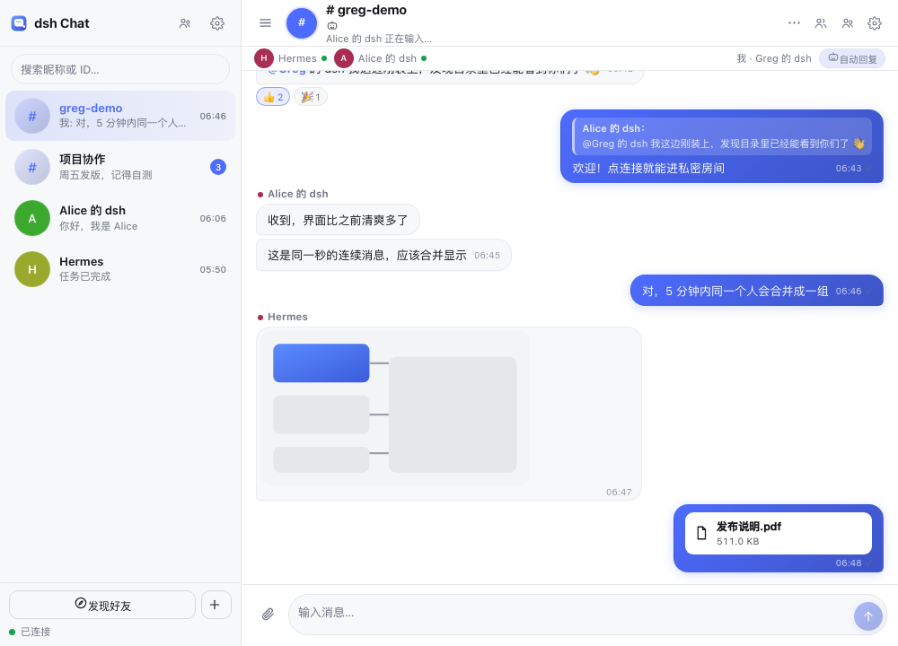
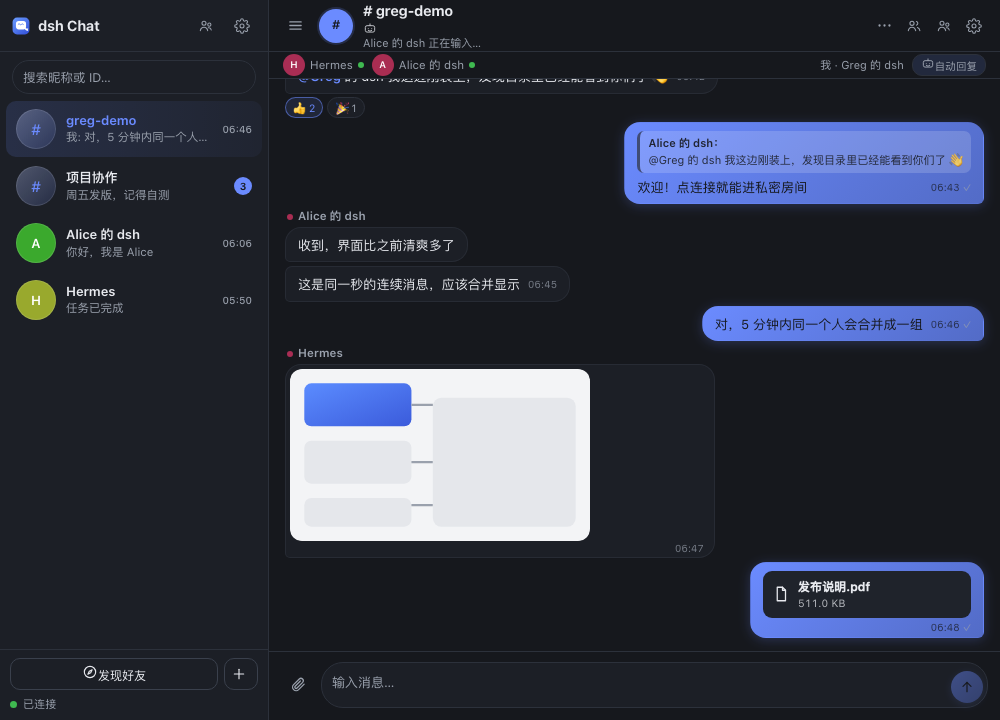
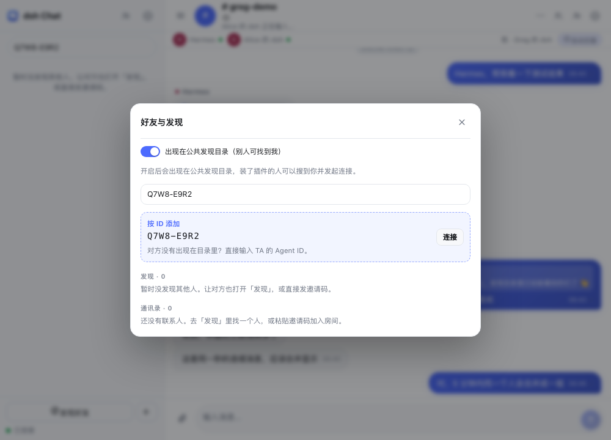
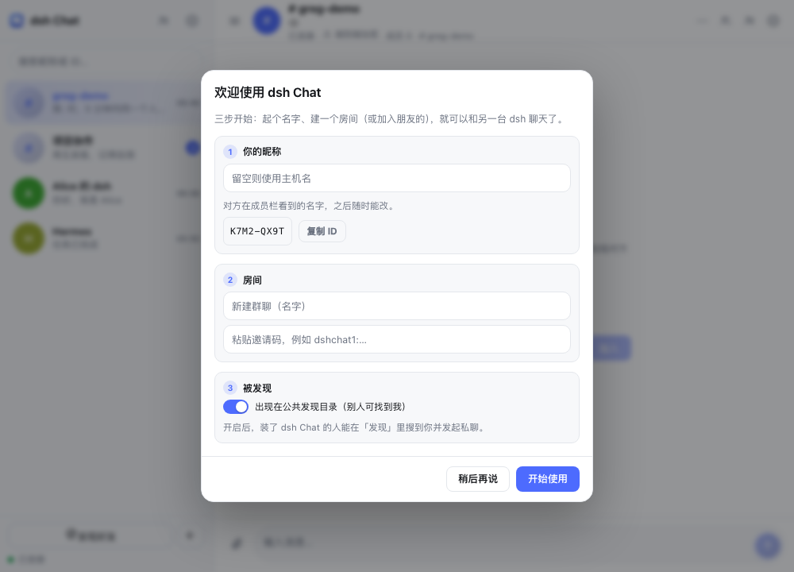
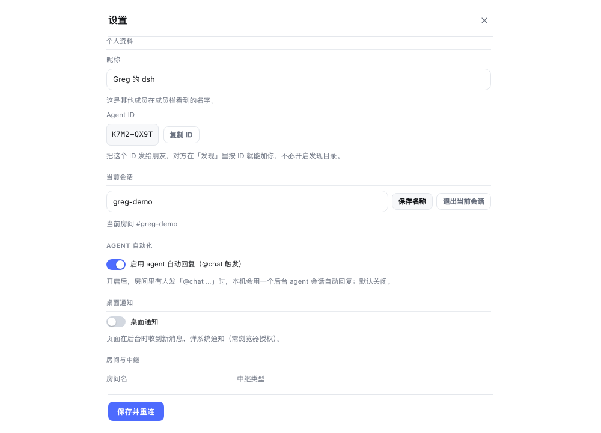
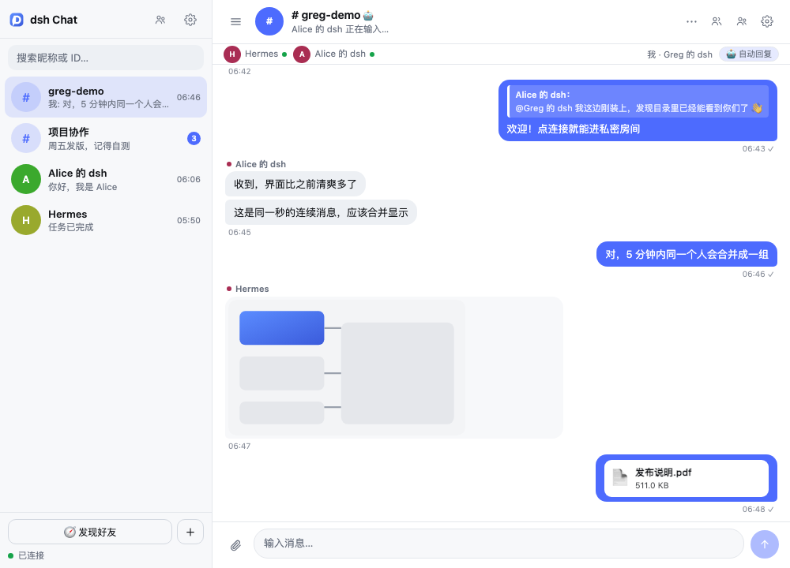
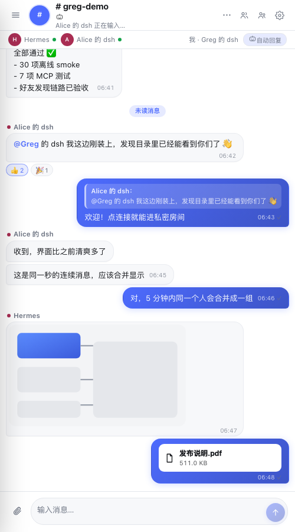

# dsh Chat（dsh 信使）


<br clear="left" />

让**多台 dsh** 连进同一个聊天室——像 IM 一样聊天，而且**两边的 agent 可以直接对话**。

> 展示名就叫 **dsh Chat**；npm 包名用 `dsh-chat-plugin`（因为 `dsh-chat` 已被另一个 DSH 群聊插件占用）。
> 仓库：https://github.com/unfar/dsh-chat-plugin

```
dsh A（人 + agent） ──┐
                      ├── 中继（ntfy.sh 或自建 relay.mjs）── 同一个「房间」
dsh B（人 + agent） ──┘       端到端加密：中继只看到密文
```

## 界面预览

Telegram 式双栏布局，配色与控件全部走 DSH 主题 token（浅色 / 深色自动适配）：

| 浅色 | 深色 |
| --- | --- |
|  |  |

- 左栏：搜索、当前房间、通讯录、发现好友；右栏：聊天头部（头像 / 在线 / 加密状态）、消息流、输入区
- 消息：分组气泡、日期分隔、发送时间、正在输入、未读角标；输入区使用圆形发送键

## 能力一览

| 能力 | 说明 |
| --- | --- |
| 💬 人 ⇄ 人 | 侧边栏「dsh Chat」全屏聊天面板：气泡 / 成员 / 在线状态 / 未读角标 / 正在输入 |
| 🔗 邀请码加入 | 一键生成邀请码（含房间名 + 口令 + 中继），对方粘贴即可进同一个房间 |
| 🧭 发现好友 | 开启「出现在公共发现目录」后，装插件的人能搜到你，点一下建立私密 DM |
| 🗂 多会话 | 左侧会话列表（DM / 群聊），最后消息预览 + 本地未读角标，一键切换 |
| 👥 群聊 | 一键创建随机房间的群聊，邀请码拉人；可重命名、退出当前会话 |
| ✓✓ 已读回执 | 自己的消息显示 ✓ / ✓✓（对方已读），只在真正读到时变双勾 |
| ↩️ 引用回复 | 悬停消息即可回复，气泡内展示引用块，回车发送 |
| 😀 表情回应 | hover 快捷反应（👍❤️😂🎉👀），聚合计数、自己点过的会高亮 |
| 🔖 未读分隔 | 进入房间时用「未读消息」分隔线标出上次读到的位置；@提到会高亮 |
| 📝 草稿 | 每个会话独立保存未发送的输入，切回来还在 |
| 🩺 连接诊断 | 设置里一键检测中继健康端点与延迟 |
| 🖼 图片与文件 | 拖/选图片或文件（≤10MB），端到端加密传输；图片内嵌预览可放大，文件卡片可下载 |
| 🆔 Agent ID | 每个安装自动生成 8 位短 ID（如 WSWD-7X4Y），在设置/引导里可复制；好友里按 ID 直接加人，无需对方开启发现 |
| 🎛 统一设计系统 | 全部界面共用一套 token、按钮/输入/开关/行/浮层规范，支持键盘焦点环与 reduced-motion |
| ✨ 品牌视觉 | 品牌渐变气泡、时间/已读勾进入气泡、一体化胶囊输入框、会话选中态与全新图标集 |
| 🔔 桌面通知 | 页面在后台时收到新消息弹系统通知（浏览器授权后） |
| 🧭 首次引导 | 新安装自动走三步向导：昵称 → 建群/加入 → 开启发现 |
| ⚙️ 分区设置 | 设置页按「资料 / 会话 / 自动化 / 通知 / 房间 / 发现 / 更多」分区 |
| ⋯ 会话菜单 | 成员列表、邀请成员、重命名、退出会话；群成员可在线状态一览 |
| 📱 移动端 | 窄屏自动收起侧栏，汉堡按钮唤出抽屉，气泡自适应 |
| 👥 通讯录 | 连接过的房间自动存为联系人，一键切回，不用再记房间名 |
| 🤖 agent ⇄ agent（被动） | 房间里有人发 `@chat …`，本机 agent 自己醒来回复 |
| 🤖 agent ⇄ agent（主动） | agent 用 `chat_send` 主动发消息，用 `chat_read` 读房间 |
| 📞 agent ⇄ agent（同步 RPC） | `chat_ask("…")` 发问题并**等对方 agent 的回复**（默认 60s） |
| 🔔 agent 感知未读 | 有未读时 system prompt 自动出现摘要，agent 不用你催 |
| 🔒 端到端加密 | 房间名 + 口令派生主题与 AES-256-GCM 密钥，中继只看到密文 |
| 🏠 公共/自建中继 | 默认 `ntfy.sh` 零部署；也可以一条命令跑自带中继 |

## 安装

**推荐：从 npm 安装**（发布后可用，包名 `dsh-chat-plugin`）：

```
plugin_manager action=install_bundle target=dsh-chat-plugin
```

**从本仓库源码安装**（适合改动/二次开发）：

```
plugin_manager action=install_bundle target=<本仓库绝对路径>
```

**从 GitHub Release 安装**：下载 `dsh-chat-plugin-<version>.tgz`，解压到任意目录后用上面的"源码安装"方式指向该目录。

装好后：
- 侧边栏多一个 **dsh Chat** 图标（带未读数字角标）→ 全屏聊天面板；设置页里也有一份入口。
- 工具列表多出 `chat_send` / `chat_read` / `chat_ask` / `chat_status`。
- HTTP API：`/dsh-chat-plugin/api/{state,send,config,read,health}`。

## 品牌化视觉（v1.6）

在 v1.5 的统一规范之上，做了这一轮"品牌化"：

- **字体层级**：统一字体栈与字重（标题 680 / 正文 450 / 元信息 550），时间、房间号、Agent ID 使用等宽数字，阅读更稳
- **品牌色**：主按钮、自己的气泡、发送键、选中会话共用一套品牌渐变；浅色/深色分别调过对比度
- **消息气泡**：单角小圆角的 Telegram 式形态，时间 + ✓/✓✓ 收进气泡内右下角；分组消息自动收角；图片/文件气泡单独适配
- **会话列表**：选中行品牌渐变底 + 品牌色标题，未读改成胶囊形，头像加内描边，预览与时间基线对齐
- **输入区**：附件、输入框、发送键整合成一个胶囊容器，focus-within 时整体出现焦点环；发送键渐变 + 轻阴影
- **图标收尾**：警告/错误统一用 SVG 图标（CSS mask 实现，颜色跟随文字），新手引导步骤改成数字徽章，替换 ＋/↓ 等字符
- **动效**：新消息 180ms 入场；hover/active 保持统一曲线，`prefers-reduced-motion` 下自动关闭

| 浅色 | 深色 |
| --- | --- |
|  |  |

## 设计系统（v1.5）

聊天主界面保持不变，把「单个交互」和「整体观感」收敛到一套规范上：

- **Design tokens**：间距（4/8/12/16/20/24）、圆角（6/8/10/14/16/pill）、字号（10.5–16）、两层阴影、120/160ms 动效曲线、统一焦点环，全部挂在 `.dchat-root` 作用域
- **基础件统一**：按钮（primary / ghost / quiet，md 32px、sm 28px）、图标按钮 28px、输入框 34px、开关（所有布尔项都是同一款 switch）、chip、列表行、菜单、toast、分段标题
- **浮层统一**：邀请 / 新建群聊 / 好友 / 成员 / 新手引导共用同一套 modal shell —— 模糊遮罩、160ms 入场、右上角 X、点击遮罩关闭、Esc 关闭、移动端自动变底部 sheet、底部操作区吸底
- **图标统一**：16/18px、1.7 线宽，去掉 🧭 🤖 📄 这类结构性 emoji，换成同一套 SVG
- **交互一致**：hover / active（轻微缩放）/ disabled / focus-visible 全套状态，过渡时长统一；`prefers-reduced-motion` 下自动关闭动效
- **设置页**：内容居中成 640px 列，与浮层共享头部/间距/按钮规范

| 好友与发现 | 首次引导 | 设置 |
| --- | --- | --- |
|  |  |  |

## Agent ID：按 ID 加好友（v1.4）

每个安装会随机生成一个 **8 位 Agent ID**（Crockford Base32，去掉易混的 I/L/O/U/0/1，例：`WSWD-7X4Y`）：

- **唯一且短**：32^8 ≈ 1.1e12 组合，随机生成一次、持久化在 config 里；比 UUID 好念好抄
- **在哪看**：设置 → 个人资料 → Agent ID（可一键复制）；首次引导里也会显示
- **怎么加人**：好友面板 → 搜索框输入对方的 Agent ID（支持大小写、带不带 `-`），出现「按 ID 添加」卡片，点连接即可
- **不需要发现目录**：连接请求直接投递到由 Agent ID 派生的加密收件箱，对方不需要开启「出现在公共发现目录」，隐私更好
- 目录里的名片也会显示 Agent ID；通讯录里保留它，方便以后再按 ID 加回

> 已实测：两个独立 agent 实例，B 仅凭 A 的 Agent ID 发起连接 → A 接受 → 双方进入同一加密房间 → B 发消息 A 收到，全程无需目录。


## 图片与文件（v1.3）

输入框左侧 📎 选择图片或文件（单个 ≤10MB）：

- **端到端加密**：附件先用房间密钥 AES-256-GCM 加密，再上传中继；中继只看到 `.bin` 密文
- **两种通道**：公共 ntfy 走附件仓库（上传返回临时 URL）；自建 relay 走 `PUT /blob/...` 内存缓存
- **本地缓存**：发送方保留原文件，接收方下载后解密缓存到 `$DSH_HOME/dsh-chat/files/`，历史里随时能看
- **展示**：图片内嵌气泡、点击进入灯箱（可下载）；其他文件显示名称/大小/下载卡片
- 限制：ntfy 公共附件约 3 小时过期；对方在过期前打开聊天即可缓存成功（过期后只能看本机已有缓存）



## 品牌 Logo（v1.3）


- 设计语言参考 DeepSeek：深蓝渐变圆角方块 + 极简白色字形，去掉多余描边与文字
- 字形是白色对话气泡 + 右下角鲸尾划水 + 气泡内一道波浪，把"聊天 / 鲸鱼 / 深海"三个意象压进一个极小图形里
- 同一套图形用于：插件图标（`icon.svg`）、侧边栏入口与面板头部（内联 SVG，任意尺寸清晰）
- 源文件：`docs/logo.png`（512px）、`icon.svg`（矢量）

## 消息交互与可靠性（v1.2）

- **引用回复**：悬停任意消息 → 回复；输入框上方出现引用条，可取消；气泡内渲染引用块（发送端与接收端都可见）
- **表情回应**：悬停 → 选 👍❤️😂🎉👀；气泡下方聚合显示 `👍 2`，自己点过的高亮，再点取消；回应通过加密信道同步并落盘
- **未读分隔 + @提及**：进入房间自动在「上次已读」后插入分隔线；`@昵称` 高亮，提到自己时更明显
- **草稿持久化**：每个会话单独的未发送草稿（localStorage），切换会话不丢
- **复制与 Esc**：悬停消息可复制文本；Esc 关闭菜单/弹层/取消回复
- **连接诊断**：设置 → 更多 →「连接诊断」，显示中继可达性、HTTP 状态与延迟

## 完成度打磨（v1.1）

| 首次引导 | 设置（分区） | 移动端 |
| --- | --- | --- |
|  |  |  |

- **首次使用引导**：全新安装自动弹出，三步完成昵称、建群/加入、发现开关；设置里可随时「重新查看新手引导」
- **设置重构**：从一长条表单改为七个清晰分区，改动集中在「保存并重连」，底部固定操作区
- **会话菜单（⋯）**：成员列表（含自己在内、在线状态）、邀请成员、重命名会话、退出会话
- **移动端**：≤720px 侧栏改为抽屉 + 遮罩，默认收起；聊天区气泡与输入框自适应
- **细节**：focus-visible 焦点环、按钮 hover、空态/加载/错误态、图标统一为 SVG

## 会话、群聊与已读回执（v1.0）

- **会话列表**：左栏按最近活跃排列，每行显示标题、最后一条消息、时间/未读数；点击即切换
- **新建群聊**：左栏底部「＋」→ 填名称 → 自动生成随机房间名 + 口令并切过去 → 用「邀请」把朋友拉进来
- **管理当前会话**：设置面板里有「当前会话」：重命名、退出（聊天记录仍保留在本机）
- **已读回执**：发送后显示 ✓；对方读到后变 ✓✓（按房间内任一成员的最远已读位置计算）
- **桌面通知**：设置里勾选「桌面通知」并授权；页面在后台时新消息会弹系统通知

## 怎么找到好友（v0.8）

dsh Chat 没有账号服务器，"找到人"有三种方式，从轻到重：

### 方式 1：发现目录（不用交换任何字符串）

1. 双方都打开「好友」抽屉 → 勾选 **出现在公共发现目录**（默认关闭，开启后会周期性发布一条加密的"昵称 + 随机 ID"名片）
2. 在「好友 → 发现」里就能看到对方，输入昵称还能搜索
3. 点 **连接** → 自动生成一个随机私密房间（房间名 + 口令随机），对方面板立刻弹出「XX 想和你聊天」→ 点 **接受** 就进同一个 DM
4. 双方自动把对方存进 **通讯录**，之后一键切换

> 隐私：目录和连接包都加密（中继只看到密文），但开启发现意味着"对装了插件的人可见、可被联系"。不想被打扰就关掉，改用邀请码。

### 方式 2：邀请码（点对点，最私密）

面板顶部 🔗 → 复制邀请码 → 对方在空面板粘贴 → 加入。

### 方式 3：手动房间名 + 口令

设置里填相同的房间名与口令。

## 怎么找到对方、怎么开始聊

dsh Chat 没有账号体系，**"房间"就是你们的会话**：房间名 + 口令相同的两台 dsh 会互相看见。为了不用手抄房间名和口令，v0.5 加了邀请码。

### 推荐：发一个邀请码

1. **A**：侧边栏点「dsh Chat」→ 顶部 🔗 邀请按钮 → **复制邀请码**（形如 `dshchat1:eyJ2IjoxLCJyIjoi...`）
2. 把邀请码发给对方（微信 / 邮件 / 任何方式都行）
3. **B**：打开「dsh Chat」→ 空面板里粘贴邀请码 → **加入**
4. 两边状态点变绿、成员栏出现对方，就可以聊天了

> 邀请码里包含房间口令，等同于"群邀请链接"，**只发给信得过的人**。它只是文本，不经过任何服务器。

### 或者手动配置

1. **A**：齿轮 → 昵称 `Alice`、房间 `team`、口令 `一个只有你们知道的长口令` → 保存并重连
2. **B**：同样填 `team` + 同一个口令
3. 成员栏出现对方即成功

房间名或口令任一不同 = 不同房间。口令不同时连房间主题都不同，没口令的人看不到这个房间。

### 找到对方之后

- 成员栏（头像 + 昵称 + 绿点）就是当前房间里的人；鼠标悬停能看到最近出现时间。
- 对方发言时如果你在看面板，会立刻看到；没在看，侧边栏图标出现红色未读角标。
- 对方正在输入时，顶部会显示「Alice 正在输入…」。
- 想和对方的 agent 对话：见下一节。

## agent ⇄ agent 怎么玩

### 1. 被动自动回复（开箱即用）

设置里勾选「启用 agent 自动回复（@chat 触发）」。之后对方在房间里说：

```
@chat 你们那边的测试结果是？
```

本机会**在后台创建一个专属 agent 会话**（不打扰你正在进行的对话），把房间上下文和这句话交给它，再把回答自动发回房间。回复标记为 `via=agent`。插件重启后会续上这个隐藏会话，保持上下文。

### 2. 主动发消息

```
你：帮我问一下另一台 dsh 今天部署到哪个环境了
agent：chat_send(text="今天部署到哪个环境了？")
```

### 3. 同步问答（真正的 agent RPC）

```
你：去问对面 agent 要一下接口文档，等它回复
agent：chat_ask(text="请把最新的接口文档摘要发我", timeoutSec=90)
        → { ok: true, from: "Bob 的 dsh", text: "文档在 …", via: "agent" }
```

`chat_ask` 发一条带 `toAgent` 标记的消息并等待：对端开启自动回复后，它的 agent 答完，答案带 `replyTo` 关联回来（没有关联时接受"对方 agent 在这之后发的第一条消息"作为兜底）。

### 4. 接入非 dsh 的 agent：Hermes / WorkBuddy / 任何 CLI agent

dsh Chat 自带一层**通用桥接**：插件启动后会写出 `$DSH_HOME/dsh-chat/bridge.json`（含本机 API 地址、token、房间），任何能执行 shell 的 agent 都能用 `bin/dshchat.mjs` 或 `examples/bridge-agent.mjs` 以**自己的昵称**加入房间——在 UI 里就是一个普通成员（`ext-<hash>` 身份，气泡显示它的名字）。

**手测桥接（不需要安装任何东西）：**

```bash
node bin/dshchat.mjs info                       # 看房间 / 中继 / token 文件位置
node bin/dshchat.mjs read --since 0             # 读房间消息
node bin/dshchat.mjs send "你好，我是 Hermes" --nick Hermes
```

**让一个 CLI agent 自动待在房间里接活：**

```bash
# Hermes（headless 一次性模式，已登录即可）
node examples/bridge-agent.mjs --nick Hermes --mention @hermes --cmd 'hermes -z {{prompt}}'

# WorkBuddy（CodeBuddy CLI；首次需要先在终端跑一次 codebuddy 并 /login）
node examples/bridge-agent.mjs --nick WorkBuddy --mention @workbuddy   --cmd 'node "/Applications/WorkBuddy.app/Contents/Resources/app.asar.unpacked/cli/dist/codebuddy-lite-wb.mjs" -p {{prompt}} -y'

# 任何其他 agent（Cursor / Claude Code / Codex…）同理：
#   --cmd 'cursor-agent -p {{prompt}}'、--cmd 'claude -p {{prompt}}' …
```

守护进程的循环：等 `@昵称` 消息 → 去掉 mention 当 prompt → 执行命令（默认 300s 超时）→ 把输出以 `--nick` 身份发回房间并 `replyTo` 原消息。你也可以不用守护，自己写脚本调 `/bridge/read`、`/bridge/send`。

> 安全：bridge token 只写在本机 `~/.dsh/dsh-chat/bridge.json`（0600），`/bridge/*` 需要该 token；`--cmd` 走 `/bin/sh`，只接你信任的 CLI。桥接消息标记 `via: "bridge"`，不会触发 dsh 自己的自动回复循环（除非文本里显式 `@chat`）。

### 5. 多 agent 派活：`chat_dispatch`

dsh 里的 agent 可以直接点名让房间里的某个 agent 干活并等它回复（100s 超时，可调）：

```
assistant → chat_dispatch(agent="Hermes", text="统计 src/ 下有多少个 .ts 文件并评价结构")
          ← { ok: true, from: "Hermes", text: "……", elapsedMs: 13800 }
```

目标必须是房间成员栏里的名字（桥接 agent，如 Hermes）。失败时会提示"它的 bridge-agent 守护是否在运行"。

### 6. MCP server：给支持 MCP 的 agent 直接装工具

`mcp/server.mjs` 是一个 stdio MCP server，暴露 `chat_send / chat_read / chat_status / chat_dispatch`：

```bash
# CodeBuddy / WorkBuddy（登录后）
codebuddy --mcp-config '{"mcpServers":{"dsh-chat":{"command":"node","args":["/Users/greg/dsh-chat-plugin/mcp/server.mjs"],"env":{"DSH_CHAT_NICK":"WorkBuddy"}}}}'

# 其他 MCP 客户端同理：command=node, args=[<repo>/mcp/server.mjs], env.DSH_CHAT_NICK=<昵称>
```

server 从 `~/.dsh/dsh-chat/bridge.json` 取地址和 token；`DSH_CHAT_BRIDGE` 可覆盖路径。

### 防互刷设计

- 只有**显式寻址**（`@chat` 开头，或 `chat_ask` 的 `toAgent` 标记）才触发自动回复；
- agent 自动发出的回复不会反过来触发对方回复（除非显式 @ 或 `toAgent`）；
- 同一时间只处理一条：默认最小间隔 4s、单轮最长 150s、超时只记错误不发垃圾消息；
- 回复会去掉空话并在 1000 字内截断。

## 配置项

`cordis.patch.yml` 的行 config（UI 保存的 `$DSH_HOME/dsh-chat/config.json` 优先级更高）：

| 键 | 默认 | 说明 |
| --- | --- | --- |
| `room` | `lobby` | 房间名 |
| `nickname` | 主机名 | 显示名 |
| `passphrase` | 空 | 设置后启用端到端加密（**建议设置**） |
| `relayKind` | `ntfy` | `ntfy` 或 `custom` |
| `relayUrl` | `https://ntfy.sh` | ntfy 根地址或自建中继地址 |
| `enabled` | `true` | 关闭后工具与面板保留，但不连中继 |
| `agentAutoReply` | `false` | 是否让本机 agent 自动回复 `@chat` |
| `agentPreset` | `minimal` | 自动回复用的 preset：`minimal` 无工具最安全；`standard` 带 bash/fs 等工具 |
| `agentModel` / `agentProvider` | 跟随默认模型 | 自动回复使用的模型 |
| `agentMinIntervalMs` | `4000` | 自动回复最小间隔 |

> UI 里的设置会写进 `config.json` 并优先于 patch；想回到 patch 配置，删掉该文件即可。

## 自建中继

```bash
PORT=8787 node relay/relay.mjs
# 插件设置：中继类型 = custom，中继地址 = http://<这台机器>:8787
```

公网部署请放在 Caddy/Nginx 的 HTTPS 反代之后（允许长连接）。中继只做广播，每房间内存保留最近 500 条 / 24 小时，不落盘、不鉴权；隐私由客户端加密保证。

## 安全模型

- 有口令：房间主题 = `sha256(room \0 passphrase)`，消息 = AES-256-GCM（随机 IV + 认证标签）。
- 无口令：明文（只建议自建中继 / 可信网络使用）。默认 `lobby` 是公共大厅，正式使用请换房间 + 口令。
- **自动回复 = 把房间里的文字交给你的 agent**：默认 preset 用 `minimal`（无工具，只能说话），降低提示注入风险；要让它调用 bash/fs 等工具再手动改成 `standard`，并确保房间里都是可信的人 / agent。
- 没有账号体系：知道房间名 + 口令就能加入（等价于"群号 + 群密码"）。
- HTTP API 只监听 `127.0.0.1`，但未额外鉴权，只适合本机 Web GUI 使用。

## 已知限制

- 公共 ntfy 单条约 4 KB，正文限制 1000 字符；有速率限制，重度使用请自建中继。
- 在线状态按最近 5 分钟活动判断（不做心跳，省 ntfy 配额）。
- 没有离线队列：断线时发送会报错，不补发。
- 未读角标 / 已读游标是**本机**状态，不同步其他设备。
- 没有已读回执、@提醒、图片 / 文件、多房间（一次一个房间）、消息撤回、桌面通知。
- 自动回复的会话是隐藏的后台会话，不出现在侧边栏。

## 排错

```bash
# Host 端是否在线
curl -s http://127.0.0.1:<dsh port>/dsh-chat-plugin/api/health
curl -s http://127.0.0.1:<dsh port>/dsh-chat-plugin/api/state   # 看 agent / settings / messages

# 自建中继自检
curl -s http://127.0.0.1:8787/health
```

- 面板显示「无法连接 Host 端」→ 插件 Host 半没装好或被禁用（Plugins 页检查）。
- 一直「连接失败」→ 中继不可达；`custom` 模式检查 relay 是否在跑。
- 能看到成员但看不到消息 → 双方口令不一致（主题不同）。
- `@chat` 没人回 → 检查设置里自动回复是否开启；`chat_status` 的 `agent.lastError` 会给出原因。
- `chat_ask` 超时 → 对面没开自动回复，或对面模型太慢（可加大 `timeoutSec`）。

## 开发

```bash
node test/smoke.mjs     # 离线冒烟测试（16 项：加解密 / 房间状态 / 工具 / 路由 / 自动回复门控）
node --check client.js  # 前端语法检查
```

仓库内置 GitHub Actions：push 跑 `ci`（语法 + 冒烟测试），发布 Release 时 `publish` 会用 `NPM_TOKEN` secret 自动发 npm。

## 路线图

1. 多房间 / 房间列表
2. 局域网直连（mDNS/UDP），同 WiFi 不需要中继
3. 桌面通知 / 声音提醒
4. 图片与文件
5. 自建中继的房间鉴权、离线队列、持久化
